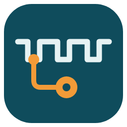

# Modbus Tap

Listen in on a Modbus RTU bus that's already in use, and turn what goes past into Home Assistant sensors. **Modbus Tap never transmits**, so your inverter's logger, dongle or meter keeps working exactly as before.

## Getting started

1. **Tap the bus.** Connect a network RS485 bridge (such as an Elfin EW11) to your bus, next to the device that's already polling it. 👉 [Tapping your bus](docs/tapping-your-bus.md) covers finding the pins with a multimeter, building a tap cable and the bridge settings.
2. **Install Modbus Tap.** In Home Assistant, open **Settings → Marketplace** (HACS before 2026.11), choose **Add from link** and paste `https://github.com/janjouketjalsma/modbus-tap`. Install **Modbus Tap**.
3. **Add the integration.** **Settings → Devices & services → Add integration → Modbus Tap**, then enter the bridge's IP address and port (8899 on Elfin devices).
4. **Check it hears the bus.** On the new bridge device, **Connection** shows *Connected* and **Frames decoded** climbs each time your logger polls. Stuck? See [troubleshooting](docs/tapping-your-bus.md#troubleshooting).
5. **Give your registers names.** Each unit on the bus appears as a device. If Modbus Tap recognises it, you'll get a repair suggesting a community map; accept it and the sensors appear. Otherwise, add your own under **Configure → Register maps**. 👉 [Register maps](docs/register-maps.md)
6. **Don't know the registers?** Record a few hours of traffic next to values you already have, and work them out yourself or with an AI assistant. 👉 [Working out a register map](docs/working-out-a-register-map.md)

## How it compares

| | Modbus Tap | ESPHome sniffer¹ | ESPHome | HA Modbus |
|---|---|---|---|---|
| Listens only (safe next to your logger) | ✅ | ✅ | ❌ | ❌ |
| Hardware | Network bridge | ESP32 + RS485 | ESP + RS485 | USB or network |
| Setup | UI | YAML + flash | YAML + flash | YAML |
| Helps find unknown registers | ✅ | ❌ | ❌ | ❌ |
| Register format | Core Modbus | ESPHome | ESPHome | Core Modbus |
| Shared maps | ✅ | ❌ | Some meters | ❌ |
| Controls the device | ❌ | ❌ | ✅ | ✅ |
| Status | New | In review | Stable | Stable |

¹ In development: [esphome/esphome#19450](https://github.com/esphome/esphome/pull/19450)

## Docs

- [Tapping your bus](docs/tapping-your-bus.md): hardware, wiring, bridge settings, troubleshooting
- [Register maps](docs/register-maps.md): the format, community maps, overrides
- [Working out a register map](docs/working-out-a-register-map.md): recordings, diagnostics, AI prompt
- [Features](docs/features.md): everything Modbus Tap does, in one page
- [Replacing your poller](docs/replacing-your-poller.md): moving to core Modbus
- [More](docs/README.md): recording format, decisions, glossary, contributing

MIT licensed. Contributions welcome, especially register maps: see [CONTRIBUTING.md](CONTRIBUTING.md).
